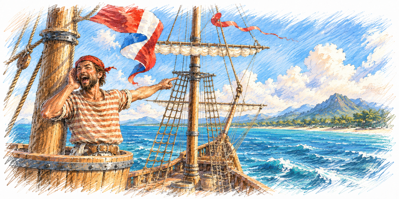

<p align="center">
  <a href="assets/screenshots/map-revealed.png"></a>
  <a href="assets/screenshots/map-colonies.png"></a>
  <a href="assets/screenshots/colony.png"></a>
</p>

# Sid Meier's Colonization — the Windows port

**Sid Meier's Colonization for Windows** (MicroProse, 1995), rebuilt to run on today's
computers: a native Windows program, with no emulator and no compatibility tricks, that also
runs on macOS and Linux. It is the same game: the same rules, the same pictures and music, and
the same saved games.

It is made from the original program's code, reconstructed function by function and checked
against it, so it plays exactly as the 1995 game does. 

## What is different

Nothing in the game itself. The rules, the computer players, the screens and the files are the
1995 game's; recorded games played by the original and by the port agree turn by turn, and saved
games move freely between the two. What the port adds:

- **It runs on modern systems**: Windows 7, 8, 10 and 11 (32-bit), and macOS and Linux
  through Wine. The 1995 program is a 16-bit Windows 3.1 program that 64-bit Windows cannot
  start at all.
- **Water colour cycling**: river currents and beach surf shimmer while the map waits for your
  orders, as in the DOS version. The Windows game kept the option but never animated it. It is
  on by default; *Game Options > Water Color Cycling* turns it off.

## What you need

The port contains no game files: you need your own copy of *Sid Meier's Colonization*. Any of
these will do:

| Your copy | Where to get it |
| --- | --- |
| **Steam**: *Sid Meier's Colonization (Classic)* | [store.steampowered.com/app/327400](https://store.steampowered.com/app/327400/) |
| **GOG**: *Sid Meier's Colonization* | [gog.com/en/game/sid_meiers_colonization](https://www.gog.com/en/game/sid_meiers_colonization) |
| **Colonization for Windows** (1995), installed from the CD-ROM, with or without MicroProse's update | — |

Steam and GOG sell the DOS release, but its CD image (`COLONIZE.ISO` on Steam, `COLONIZE.GOG` on
GOG) also carries the Windows edition; the port takes it from there by itself. Make sure you buy
the 1994 *Classic* game, not *Civilization IV: Colonization* (2008).

Steam's and GOG's copies are the original 1995 release, before MicroProse's update. The update
added the Jukebox's Control Panel and the Cheat menu's dialogs, which therefore do not work with
those copies; everything else does.

## Download

Get the latest kit from the [releases page](https://github.com/OpenCol/win-port/releases):

| Kit | For |
| --- | --- |
| `colonization-port-windows-x86.zip` | Windows 7 or later, 32- or 64-bit |
| `colonization-port-macos.zip` | macOS (needs Wine, see below) |
| `colonization-port-linux-i386.zip` | Linux (needs Wine, see below) |

## How to run it

### Windows

1. Unzip the kit. The easiest place is inside your game's folder: the Steam or GOG
   Colonization folder (in Steam: right-click the game > *Manage* > *Browse local files*), or the
   folder of your installed Colonization for Windows.
2. Start `Colonization.exe`.

It looks for the game in the folder you started it from, in its own folder and the one above
it, and in the folder it used last time. If it finds none there, it asks you to choose your game
folder, and remembers your choice.

With a Steam or GOG copy, the first start unpacks the Windows edition from the CD image, once,
into `%LOCALAPPDATA%\colonization-port\game`, and plays from there: your saved games are kept in
that folder. With an installed Colonization for Windows, they are kept in its own folder, as
the original kept them.

### macOS

The Mac kit runs the Windows program through **Wine**, which you install first: Gcenx's builds,
`brew install --cask wine@devel` (or from
[github.com/Gcenx/macOS_Wine_builds](https://github.com/Gcenx/macOS_Wine_builds)). Apple's Game
Porting Toolkit (Wine 7.7, often Homebrew's `wine64`) does not work: the game stops at its first
sound. On Apple silicon, Rosetta 2 runs it.

Unzip the kit and start it from Terminal, the first time with your game folder:

```sh
./colonization "/path/to/your/Colonization"
./colonization                              # later: the folder is remembered
```

Without a folder it looks in the same places as on Windows, then asks. Steam and GOG copies are
unpacked into `~/Library/Application Support/colonization-port/game`, where the saved games are
kept.

### Linux

The Linux kit is the port built against Wine's libraries, so it also needs **Wine**, with its
32-bit part (Debian or Ubuntu: `sudo dpkg --add-architecture i386 && sudo apt install wine
wine32`). Unzip it and run `./colonization "/path/to/your/Colonization"` as on macOS. Steam and
GOG copies are unpacked into `~/.local/share/colonization-port/game`.

## Reporting a bug

Something that does not work, works differently from the 1995 game, or stops the game: please
[open an issue](https://github.com/OpenCol/win-port/issues/new) on GitHub (you need a free
GitHub account). Check the [open issues](https://github.com/OpenCol/win-port/issues) first: it
may be known already, and a comment there helps too.

Every run writes a log, `colonization-port.log`, next to `Colonization.exe` (on macOS and
Linux, next to the `colonization` script). It says what the launcher found, your system, and,
if the game stopped, what it was doing; a crash also leaves `colonization-port.dmp` beside it.
The log keeps every run, the newest at the end; the `.dmp` file is replaced by the next crash's,
so take it before playing again. (If the kit's folder cannot be written to, the log is in your
`%TEMP%` folder instead.)

In the issue, please give:

- **what happened**, and what you expected instead;
- **how to make it happen again**, step by step, if you can;
- **the port's version** (the release you downloaded, e.g. v0.1.10) and **your system**
  (Windows 7, 10 or 11; macOS or Linux, and which Wine);
- **your copy of the game**: Steam, GOG, or the 1995 CD (updated or not);
- **the files**, dragged into the issue's text box:
  - `colonization-port.log` as it is;
  - `colonization-port.dmp`, if there is one, zipped first (GitHub takes `.zip`, not `.dmp`);
  - a saved game just before the problem, zipped, if it happens in a game. Your saves are
    the `.SAV` files in your game folder (see *How to run it* for where that is).

The log shows the folder paths on your computer, which may include your user name; edit it out
if you prefer.

## For developers

How the port is built, tested and released, and where its code comes from:
[docs/DEVELOPING.md](docs/DEVELOPING.md). Milestones and test results: [STATUS.md](STATUS.md).
What changed in each release: [NEWS.md](NEWS.md).

---



*Sid Meier's Colonization* is © 1994–1995 MicroProse Software, Inc. This project is not
affiliated with or endorsed by MicroProse, Take-Two Interactive, Firaxis Games or Sid Meier.
