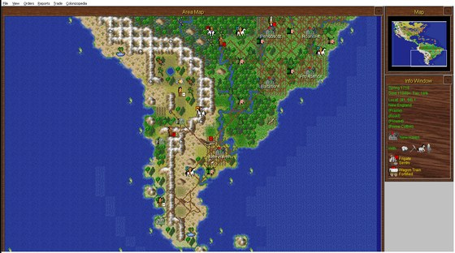
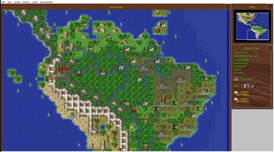
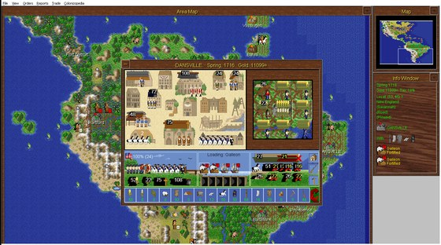

<p align="center">
  <a href="assets/screenshots/map-revealed.png"></a>
  <a href="assets/screenshots/map-colonies.png"></a>
  <a href="assets/screenshots/colony.png"></a>
</p>

# Sid Meier's Colonization - Windows port

Sid Meier's Colonization for Windows (MicroProse, 1995), rebuilt so it runs on today's computers. It's a native Windows program with no emulator and no compatibility mode, and it also runs on macOS and Linux through Wine.

It's the same game. The code was reconstructed from the original program function by function and checked against it, so the rules, the AI, the graphics, the music and the save files are all the 1995 ones.

## What's different

Not much, on purpose:

- It runs on modern systems. The 1995 game is a 16-bit Windows 3.1 program and 64-bit Windows won't start it at all. The port runs on Windows 7, 8, 10 and 11 (it's a 32-bit program), and on macOS and Linux with Wine.
- Water colour cycling. Rivers and coastlines shimmer while the map waits for your orders, like in the DOS version. The Windows version had the option in its menu but never actually animated anything. It's on by default, and you can turn it off in *Game Options > Water Color Cycling*.

Saved games work both ways: the port loads your old saves, and the original loads the port's.

## What you need

The port doesn't include any game files, so you need your own copy of Colonization. Any of these works:

| Your copy | Where to get it |
| --- | --- |
| Steam: *Sid Meier's Colonization (Classic)* | [store.steampowered.com/app/327400](https://store.steampowered.com/app/327400/) |
| GOG: *Sid Meier's Colonization* | [gog.com/en/game/sid_meiers_colonization](https://www.gog.com/en/game/sid_meiers_colonization) |
| Colonization for Windows (1995) installed from the CD-ROM, patched or not | - |

Steam and GOG sell the DOS version, but its CD image (`COLONIZE.ISO` on Steam, `COLONIZE.GOG` on GOG) has the Windows version on it too, and the port unpacks it by itself. Just make sure you get the 1994 *Classic* game and not *Civilization IV: Colonization* (2008).

One catch: Steam and GOG have the original 1995 release, without MicroProse's later update. The update added the Jukebox's Control Panel and the Cheat menu's dialogs, so those don't work with Steam or GOG copies. Everything else does.

## Download

Grab the latest kit from the [releases page](https://github.com/OpenCol/win-port/releases):

| Kit | For |
| --- | --- |
| `colonization-port-windows-x86.zip` | Windows 7 or later, 32- or 64-bit |
| `colonization-port-macos.zip` | macOS (needs Wine, see below) |
| `colonization-port-linux-i386.zip` | Linux (needs Wine, see below) |

## How to run it

### Windows

1. Unzip the kit, ideally right into your game folder: the Steam or GOG Colonization folder (in Steam: right-click the game > *Manage* > *Browse local files*), or wherever your Colonization for Windows is installed.
2. Run `Colonization.exe`.

The launcher looks for the game in the current folder, in its own folder and the one above it, and in the folder you used last time. If it can't find it, it asks you where it is and remembers the answer.

With a Steam or GOG copy, the first start unpacks the Windows version from the CD image into `%LOCALAPPDATA%\colonization-port\game` (just once), and your saves go there too. With an installed Colonization for Windows, saves stay in the game folder like they always did.

### macOS

You need Wine first. Use Gcenx's build: `brew install --cask wine@devel`, or download it from [github.com/Gcenx/macOS_Wine_builds](https://github.com/Gcenx/macOS_Wine_builds). Don't use Apple's Game Porting Toolkit (Wine 7.7, often installed as Homebrew's `wine64`), because the game stops the first time it plays a sound. On Apple Silicon it runs through Rosetta 2.

Then unzip the kit and run it from Terminal. The first time, give it your game folder:

```sh
./colonization "/path/to/your/Colonization"
./colonization                              # after that, it remembers the folder
```

Without a folder it searches the same places as on Windows, and asks if it finds nothing. Steam and GOG copies get unpacked into `~/Library/Application Support/colonization-port/game`, which is also where your saves end up.

### Linux

The Linux kit is built against Wine's libraries, so you need Wine with its 32-bit part (Debian or Ubuntu: `sudo dpkg --add-architecture i386 && sudo apt install wine wine32`). Unzip it and run `./colonization "/path/to/your/Colonization"`, same as on macOS. Steam and GOG copies get unpacked into `~/.local/share/colonization-port/game`.

## Found a bug?

Please [open an issue](https://github.com/OpenCol/win-port/issues/new) on GitHub (you'll need a free account). Have a quick look at the [open issues](https://github.com/OpenCol/win-port/issues) first. It might already be reported, and a comment there helps too.

Every run writes `colonization-port.log` next to `Colonization.exe` (or next to the `colonization` script on macOS and Linux). It records what the launcher found, your system and, if the game crashed, what it was doing. A crash also leaves `colonization-port.dmp` next to it. The log keeps every run with the newest at the end, but the `.dmp` gets overwritten by the next crash, so grab it before you play again. If the kit's folder isn't writable, the log goes to your `%TEMP%` folder instead.

It helps a lot if the issue has:

- what happened, and what you expected to happen
- the steps to make it happen again, if you can
- the port's version (e.g. v0.1.10) and your system (Windows 7, 10 or 11, or macOS or Linux and which Wine)
- your copy of the game: Steam, GOG or the 1995 CD (patched or not)
- the files, dragged into the issue:
  - `colonization-port.log`
  - `colonization-port.dmp` if there is one, zipped first (GitHub doesn't take `.dmp` files)
  - a save from just before the problem, zipped, if it happens in a game. Saves are the `.SAV` files in your game folder (see *How to run it* above for where that is).

The log contains folder paths from your computer, which may include your user name. Feel free to edit that out.

## For developers

How the port is built, tested and released, and where the code comes from: [docs/DEVELOPING.md](docs/DEVELOPING.md). Milestones and test results are in [STATUS.md](STATUS.md), and what changed in each release is in [NEWS.md](NEWS.md).

---


*Sid Meier's Colonization* is © 1994-1995 MicroProse Software, Inc. This project isn't affiliated with or endorsed by MicroProse, Take-Two Interactive, Firaxis Games or Sid Meier.
